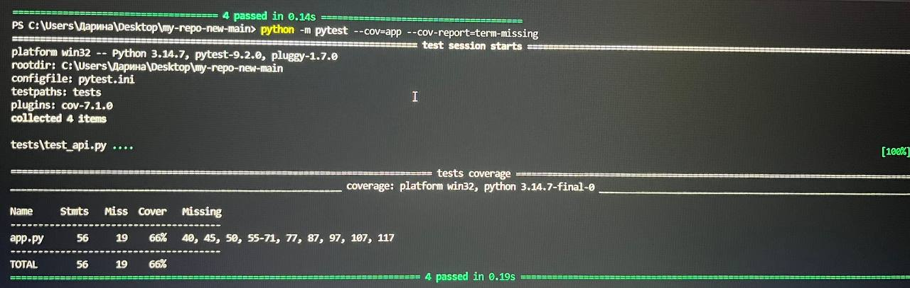

# Тестування застосунку ('TESTING.md')

## 1. Команди запуску тестів та покриття коду
* Запуск усіх тестів:
  ```bash
  python -m pytest

* Детальний запуск тестів:
  ```bash
  python -m pytest -v

* Перевірка покриття коду:
  ```bash
  python -m pytest --cov=app --cov-report=term-missing

## 2. Unit тести (tests/test_validators.py)

| № | Назва тесту | Що перевіряє | Очікуваний результат |  
| --- | --- | --- | --- |
| 1 | test_... | Перевірка валідації вхідних даних | Очікуваний результат валідації | 

## 3. Integration тести API(tests/test_api.py)

| № | Назва тесту | Що перевіряє | Очікуваний результат |
|--- | --- | --- | --- |
| 1 | test_get_products_success | Отримання списку товарів(GET) | Статус 200, повертається список товарів |
| 2 | test_create_product_success | Створення нового товару(POST) | Статус 201, запис створено  із коректними даними |
| 3 | test_create_product_bad_request | Надсилання некоректних даних при створенні(POST) | Статус 400, запис не створено |
| 4 | test_get_product_not_found | Запит до неіснуючого товару | Статус 404 |

## 4. Скріншоти заусків та покриття коду
* Результати pytest -v:

* Покриття коду (--cov):


## 5. Висновки
* Усі 4 integration тести у tests/test_api.py пройшли успішно (4 passed).
* Покриття коду для app.py склало 66% (56 інструкцій, 19 пропущено).
* Оформлено документацію тестування у TESTING.md із командами запуску, описами сценаріїв та висновками.
