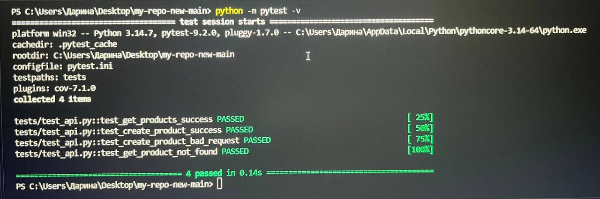

#Тестування застосунку ('TESTING.md')

## 1. Команди запуску тестів та покриття коду
* Запуск усіх тестів:
  ```bash
  python -m pytest

* Детальний запуск тестів:
  python -m pytest -v

* Перевірка покриття коду:
  python -m pytest --cov=app --cov-report=term-missing

## 2. Unit тести (tests/test_validators.py)

№ | Назва тесту | Що перевіряє                      | Очікуваний результат  

1 | test_...    | Перевірка валідації вхідних даних | Очікуваний результат валідації  

## 3. Integration тести API(tests/test_api.py)

№|  Назва тесту     | Що перевіряє                 | Очікуваний результат

1| test_get_produc  | Отримання списку товарів(GET)| Статус 200, повертається 
 |  ts_success      |                              | список товарів

2| test_create_pro  | Створення нового товару(POST)| Статус 201, запис створено
 |duct_success      | із коректними даними         |

3|test_create_pro   | Надсилання некоректних даних | Статус 400, запис не створено
 |  duct_bad_request| при створенні(POST)          |

4| test_get_produc  | Запит до неіснуючого товару  | Статус 404
 |  t_not_found     |                              |

## 4. Скріншоти заусків та покриття коду
* Результати pytest -v:

* Покриття коду (--cov):


## 5. Висновки
* Усі 4 integration тести у tests/test_api.py пройшли успішно (4 passed).
* Покриття коду для app.py склало 66% (56 інструкцій, 19 пропущено).
* Оформлено документацію тестування у TESTING.md із командами запуску, описами сценаріїв та висновками.